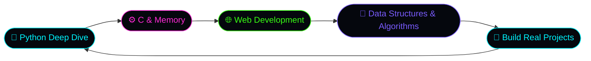

<div align="center">


<a href="https://git.io/typing-svg">
  
</a>

<br/>


</div>


## `>_` BOOT SEQUENCE

<div align="center">



</div>


## `{ }` ABOUT_ME.PY

```python
from curiosity import why
from coffee import fuel


class Aathfi:
    name     = "Muhammad Aathfi Amer"
    role     = "First-year Computer Science Student"
    status   = "Learning"
    maths    = "top-notch"
    languages = {"Python": "comfortable", "C": "learning (in progress)"}
    interests = ["python", "web development", "low-level curiosity",
                 "problem-solving", "how things actually work"]

    def dive_deep(self, problem):
        """One real problem at a time."""
        answer = self.solve(problem)
        reasoning = self.explain(how=answer)   # not just state the answer
        return answer, reasoning

    def solve(self, problem):
        while not problem.solved:
            fuel(self)
            why(problem)          # every expert was once a beginner
        return problem.solution

    def __repr__(self):
        return "still learning. already building."


if __name__ == "__main__":
    me = Aathfi()
    print(me)   # -> still learning. already building.
```

## `[#]` WHAT I'M ABOUT

| `//` | |
|:--|:--|
| 🧠 | **Understanding how things work, not just what works** |
| 🔧 | **Getting comfortable with problem-solving as a craft** |
| 🔬 | **Diving deep into Python, one real problem at a time** |
| 🗣️ | **Training myself to explain *how* an answer came to be, not just state it** |
| ⚙️ | **Going low-level with C, curious about what's under the hood** |
| 🌐 | **Building for the web, growing a little every day** |

## `<>` TECH ARSENAL

<div align="center">


</div>

### `%` LOADING PROGRESS

```text
Python        [██████████████░░░░░░]  70%   comfortable
Web Dev       [██████████░░░░░░░░░░]  50%   building
C (low-level) [████████░░░░░░░░░░░░]  40%   loading...
Mathematics   [███████████████████░]  95%   top-notch
Curiosity     [████████████████████] 100%   ∞  never stops
Coffee        [████████████████████] 100%   critical dependency
```

## `~` CURRENT LEARNING ROADMAP




## `#` TELEMETRY

<div align="center">


<br/>


<br/><br/>


</div>

## `🐍` CONTRIBUTION SNAKE

<div align="center">


</div>

## `🏆` TROPHY ROOM

<div align="center">


</div>


<div align="center">

### 💭 `motto.txt`

<a href="https://git.io/typing-svg">
  
</a>

<br/>

```text
   ┌───────────────────────────────────────┐
   │   while alive:  learn()  build()  why()│
   └───────────────────────────────────────┘
```


</div>
